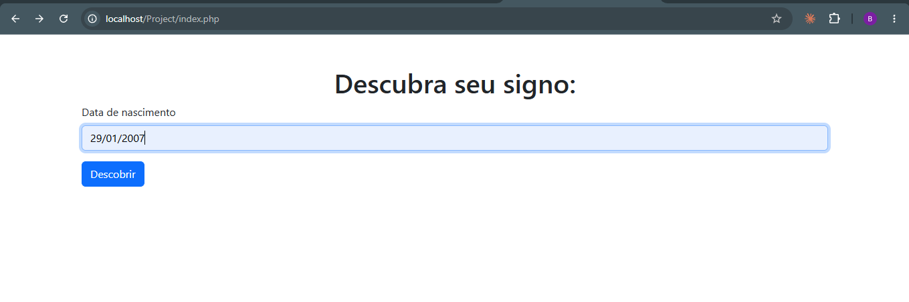

Consulta de Signos – PHP, XML e Bootstrap

Aplicação web simples que descobre o signo zodiacal de uma pessoa a partir da data de nascimento. O usuário digita a data em um formulário, o PHP compara essa data com os períodos de cada signo (guardados em um arquivo XML) e a página mostra o signo e sua descrição.

Projeto desenvolvido como aula prática da disciplina Programação Web (Unidade 1 – Fundamentos da Web com HTML5, Aula 4 – Exercícios práticos com HTML), do curso superior de Tecnologia em Análise e Desenvolvimento de Sistemas da Anhanguera Educacional.

Funcionalidades
Formulário HTML para informar a data de nascimento (dd/mm/aaaa).
Leitura dos dados dos 12 signos a partir de um arquivo XML.
Identificação do signo pela data, incluindo o caso de Capricórnio, que atravessa a virada do ano (22/12 a 20/01).
Página de resultado com o nome e a descrição do signo.
Mensagem de erro para datas inválidas.
Interface estilizada com Bootstrap.
Tecnologias
Tecnologia	Uso
HTML5	Estrutura das páginas e formulário
PHP 8	Processamento do formulário e lógica de busca
XML	Armazenamento dos dados dos signos
Bootstrap 5.2 (CDN)	Estilização
CSS	Ajustes de estilo (assets/css/style.css)
XAMPP (Apache + PHP)	Servidor local
Visual Studio Code	Editor de código
Estrutura do projeto
Project/
├── assets/
│   ├── css/
│   │   └── style.css          # estilos do cartão de resultado
│   ├── imgs/
│   └── js/
├── layouts/
│   └── header.php             # <head> reutilizado nas páginas (inclui o Bootstrap)
├── index.php                  # página inicial com o formulário
├── show_zodiac_sign.php       # recebe a data, busca o signo e mostra o resultado
└── signos.xml                 # dados dos 12 signos
Como executar
Instale o XAMPP.
Copie esta pasta para dentro de C:\xampp\htdocs\ (o nome da pasta usado nos exemplos é Project).
Abra o XAMPP Control Panel e inicie o Apache (botão Start).
Acesse no navegador:
http://localhost/Project/index.php

O PHP precisa ser executado por um servidor. Abrir os arquivos direto pelo Explorer do Windows (file:///...) não funciona.

Como funciona
index.php mostra o formulário. O campo data_nascimento é enviado pelo método POST para show_zodiac_sign.php.
show_zodiac_sign.php recebe o valor em $_POST['data_nascimento'] e carrega o signos.xml com simplexml_load_file.
O PHP percorre cada <signo> do XML. Como as datas do XML têm só dia e mês (21/03) e a data digitada tem ano, elas são convertidas em datas completas (DateTime) usando o ano de nascimento informado. Assim a comparação é feita em ordem cronológica, e não como texto.
Para o signo que atravessa a virada do ano (Capricórnio), o fim do período passa para o ano seguinte (se a pessoa nasceu em dezembro) ou o início passa para o ano anterior (se nasceu em janeiro).
Quando a data está dentro do intervalo dataInicio – dataFim, a página exibe o nome e a descrição do signo. Se a data for inválida, exibe um aviso.
Estrutura do signos.xml
xml
<signos>
    <signo>
        <dataInicio>21/03</dataInicio>
        <dataFim>20/04</dataFim>
        <signoNome>Áries</signoNome>
        <descricao>Áries é o primeiro signo do zodíaco...</descricao>
    </signo>
    <!-- ... demais signos ... -->
</signos>

Para corrigir uma descrição ou um período, basta editar o XML, sem mexer no código PHP.

Testes realizados
Data informada	Signo esperado	Observação
21/03/1995	Áries	início do intervalo
20/04/1995	Áries	fim do intervalo
21/05/1992	Gêmeos	exemplo do roteiro
19/02/1998	Aquário	fim do intervalo
20/02/1998	Peixes	início do intervalo
22/12/2000	Capricórnio	início do intervalo que cruza o ano
01/01/2000	Capricórnio	data após a virada do ano
abc	mensagem de erro	data inválida
Capturas de tela

Formulário – página inicial, com a data de nascimento digitada:

Resultado – signo e descrição exibidos após clicar em Descobrir (exemplo: 29/01/2007 → Aquário):

O que foi aprendido
Criação e manipulação de arquivos XML.
Desenvolvimento de formulários HTML e integração com PHP (método POST).
Lógica condicional e manipulação de datas em PHP.
Reaproveitamento de código com include.
Estilização de páginas com Bootstrap.
Autor

Bruno Henrique dos Santos Curso Superior de Tecnologia em Análise e Desenvolvimento de Sistemas – Anhanguera Educacional